# 📱 AttendKH Mobile Application — Smart Attendance & Enterprise HR Suite

<p align="center">
  <sub>Developed by <strong>Seng Chhunsour</strong></sub>
</p>

<p align="center">
  <a href="https://github.com/Chhunsour"></a>
  
  
  
  
</p>

> **Official Cross-Platform Mobile Client for iOS & Android**  
> **Production Repository**: `https://github.com/NetVanna/mpg-hr-mobile-app`  
> **Framework**: Flutter 3.x / Dart 3.12+ (Null-Safe)  
> **Scale**: 132,000+ Lines of Production Dart Code | 3 Distinct Role Shells | 35+ Dedicated Screens | 50+ Custom Widgets & Sheets | Bilingual (English & Khmer)

---

## 📑 Table of Contents
1. [Ecosystem & App Overview](#1-ecosystem--app-overview)
2. [Dynamic Shells & Navigation Architecture](#2-dynamic-shells--navigation-architecture)
3. [Technology Stack & Core Libraries](#3-technology-stack--core-libraries)
4. [Employee Self-Service Shell (`/main/*`)](#4-employee-self-service-shell-main)
5. [Company Admin & HR Command Shell (`/company-admin/*`)](#5-company-admin--hr-command-shell-company-admin)
6. [Platform Super Admin Shell (`/admin/*`)](#6-platform-super-admin-shell-admin)
7. [Cambodian Labor Law & Localization Integrations](#7-cambodian-labor-law--localization-integrations)
8. [Hardware, Sensors & Security Architecture](#8-hardware-sensors--security-architecture)
9. [Directory Layout](#9-directory-layout)
10. [Local Development, Build & Release Commands](#10-local-development-build--release-commands)

---

## 1. Ecosystem & App Overview

The **AttendKH Mobile Application** is a full-featured enterprise workforce management and smart attendance mobile suite designed specifically for businesses in Cambodia and Southeast Asia. 

Rather than a simple punch-clock utility, AttendKH is a **complete, standalone enterprise management workstation** that enables employees, branch managers, HR directors, company owners, and SaaS platform administrators to handle 100% of their daily operational tasks without needing a desktop browser.

```mermaid
graph TD
    User([User Logs In]) --> AuthState{Evaluates Role & Tenant}
    AuthState -->|Employee / Staff| EmpShell[Employee Shell]
    AuthState -->|Owner / Admin / HR / Branch Mgr| AdminShell[Company Admin Shell]
    AuthState -->|Platform Super Admin| SuperShell[Super Admin Shell]

    subgraph "Employee Shell (/main/*)"
        EmpShell --> E1[Live Clock-In / GPS Geofence]
        EmpShell --> E2[Leave Balances & Requests]
        EmpShell --> E3[Payslips & PDF Downloads]
        EmpShell --> E4[Overtime & Expense Claims]
        EmpShell --> E5[Documents, Policies & Rules]
        EmpShell --> E6[KPIs, Training & Holidays]
    end

    subgraph "Company Admin Shell (/company-admin/*)"
        AdminShell --> A1[Live Presence Dashboard]
        AdminShell --> A2[Staff Directory & Details]
        AdminShell --> A3[HR Structure: Branches, Depts, Org Chart]
        AdminShell --> A4[Shift Schedules & Exceptions]
        AdminShell --> A5[Approval Queues: Leave / OT / Expense]
        AdminShell --> A6[Payroll Engine & Cambodian Formulas]
        AdminShell --> A7[Recruitment & Candidate ATS]
        AdminShell --> A8[Company Asset Management]
        AdminShell --> A9[Performance Reviews & KPIs]
        AdminShell --> A10[BI Analytics & Report Exports]
        AdminShell --> A11[Branch Impersonation View]
    end

    subgraph "Super Admin Shell (/admin/*)"
        SuperShell --> S1[Platform Metrics & MRR/ARR]
        SuperShell --> S2[Tenant Companies & Subscriptions]
        SuperShell --> S3[Master Spatie Permission Matrix]
        SuperShell --> S4[System Health & Queue Control]
        SuperShell --> S5[Audit Logs & Login History]
        SuperShell --> S6[Global Support Desk]
    end
```



---

## 2. Dynamic Shells & Navigation Architecture

The application selects its root layout shell dynamically based on the authenticated user's permissions:

| User Role | Default Landing Shell | Primary Capabilities |
| :--- | :--- | :--- |
| **`employee`** | `EmployeeShell` (`/main`) | Personal GPS punch in/out, view digital payslips, apply for leave, submit overtime & expenses, download employment contracts. |
| **`department_head`** | `EmployeeShell` + Scoped Approvals | Full employee capabilities plus team attendance oversight and departmental leave approvals. |
| **`branch_manager`** | `CompanyAdminShell` (Branch Scoped) | Real-time presence for assigned branch, shift management, branch leave approvals. (Payroll/financial modules are hidden). |
| **`hr_manager`** | `CompanyAdminShell` (Company-Wide) | Full HR operations: Staff directory, onboarding, organizational structure, shift schedules, recruitment ATS. (Payroll tab is hidden). |
| **`company_admin`** | `CompanyAdminShell` (Executive) | Complete operational & financial management: live branch switcher, payroll runs, financial reports, asset tracking. |
| **`company_owner`** | `CompanyAdminShell` (Full Access) | Master company access: top employee rankings, salary formula adjustments, role configurations, branch management. |
| **`super_admin`** | `SuperAdminShell` (`/admin`) | SaaS platform administration: tenant company onboarding, plan upgrades, system health, server cache flushing, security audit logs. |

---

## 3. Technology Stack & Core Libraries

* **State Management**: `flutter_riverpod: ^2.6.1` with `riverpod_annotation`
* **Navigation / Routing**: `go_router: ^14.8.1` (`lib/utils/router/app_router.dart` with role-based route guards and `IndexedStack` state preservation)
* **Networking**: `dio: ^5.7.0` (`DioClient` with automatic Bearer token injection, `X-Company-Id` tenant isolation header, and offline detection)
* **Storage**: `flutter_secure_storage: ^9.2.4` (encrypted keychain tokens) & `shared_preferences: ^2.3.5`
* **Hardware & Location**: `geolocator: ^14.0.2` & `geocoding: ^4.0.0` (precision GPS & branch geofencing)
* **Camera & Media**: `image_picker: ^1.2.3` & `flutter_image_compress: ^2.4.0` (selfie verification, receipts, background compression)
* **Notifications**: `firebase_messaging: ^15.2.4` & `flutter_local_notifications: ^18.0.1` (remote FCM push notifications & deep-link routing)
* **File Operations**: `open_filex: ^4.7.0` & `path_provider: ^2.1.6` (PDF payslip and contract viewing)
* **Calendar Engine**: `table_calendar: ^3.2.0` (interactive monthly attendance and public holiday calendar)
* **Design Tokens**: Custom `AppTheme` / `AppColors` supporting Light & Dark modes seamlessly

---

## 4. Employee Self-Service Shell (`/main/*`)

### 4.1 Smart Attendance & Geofenced Clock-In Engine
* **GPS Geofence Validation**: Validates current device coordinates against branch coordinates (`latitude`, `longitude`) within the branch's `allowed_radius_meters`.
* **Four Clock Phases**:
  * `readyToClockIn`: Green state, prompts swipe to clock in.
  * `working`: Amber state, active shift running.
  * `readyToClockOut`: Triggers once shift duration is met.
  * `done`: Shift finished.
* **Cambodia Late Arrival Reasons**: Prompts mandatory explanation chips when arriving past grace period:
  * 🚗 Heavy Traffic (ស្ទះចរាចរណ៍)
  * 🌧️ Heavy Rain (ភ្លៀងធ្លាក់ខ្លាំង)
  * 🛵 Vehicle Breakdown (យានជំនិះមានបញ្ហា)
  * 🏥 Medical Clinic (ពិនិត្យសុខភាព)
  * 👨‍👩‍👧 Family Emergency (ការងារគ្រួសារបន្ទាន់)
  * ✏️ Custom written explanation
* **Photo Verification**: Captures front-camera selfie with an animated scanning reticle, automatically compresses the image, and uploads it with the punch payload.
* **Overtime Clocking**: Supports separate `overtime-in` and `overtime-out` punches with GPS verification.

### 4.2 Attendance History & Correction Requests (`/main/attendance`)
* Monthly summary cards (Present, Late, Absent, Half-Day, Total Hours).
* Daily punch timeline displaying timestamps, selfie photos, GPS validity, and late duration.
* **Attendance Correction Flow**: Submit adjustment requests for missed punches with reasons for HR approval.

### 4.3 Leave Management & Balances (`/main/leave`)
* Live balances for Annual, Sick, Personal, Maternity, Paternity, Bereavement, and Unpaid leave.
* Smart leave application automatically **excludes public holidays and weekends** from deducted day counts.
* Morning and Afternoon half-day support.
* Medical certificate and document attachment upload.

### 4.4 Digital Payslips & Compensation (`/main/payslip`)
* Monthly salary cards with gross salary, basic salary, allowances, tax, late deductions, and net pay.
* **Secure PDF View & Download**: Uses **short-lived signed URLs** (`/company/my-payslips/:id/view-link`), ensuring long-lived API tokens are never exposed to browser history or system downloaders.

### 4.5 Overtime & Expense Claims (`/request-overtime`, `/main/expense`)
* Overtime application with project justification, estimated duration, and automatic rate multiplier previews.
* Expense claims with receipt camera upload, full-screen zoom preview, and reimbursement tracking.

### 4.6 Documents, Rules, Policies & Holiday Calendar
* Encrypted personal document repository (employment contracts, ID cards, certificates) with in-app PDF preview.
* Searchable company rules and corporate policy handbook.
* Interactive Cambodian national holiday calendar with countdown badges ("Tomorrow", "in 4 days", "Today 🎉").
* In-app support desk ticketing system with priority and category tagging.

---

## 5. Company Admin & HR Command Shell (`/company-admin/*`)

### 5.1 Executive Operations Dashboard
* Real-time counters: *Clocked In*, *Late Arrivals*, *Absent*, *On Leave*, and *On Break*.
* Actionable 1-tap approval queues: Pending Leaves, Pending Overtime, Pending Expenses.
* **Dynamic Branch Switcher**: Instantaneous filtering of all dashboards and tabs by specific branch or company-wide.
* **Branch Impersonation View**: Owners and admins can inspect any branch's real-time operations as a branch manager.

### 5.2 Staff Directory & Employee Lifecycle Management (`/company-admin/employees`)
* Multi-criteria staff search (Department, Branch, Employment Status, Employment Type).
* Detailed employee profile view: identity, emergency contacts, compensation, bank details, documents, attendance logs, and leave balances.
* Create and edit employee modal with photo upload.

### 5.3 Organizational Structure Architect (`/company-admin/hr-structure`)
* **Branches Tab**: Setup locations, GPS coordinates, allowed radius, grace periods, and early clock-in policies.
* **Departments Tab**: Manage corporate departments, assign department heads, and track headcounts.
* **Positions Tab**: Configure organizational job titles, seniority levels, and department associations.
* **Teams Tab**: Cross-functional team groupings with assigned leads.
* **Interactive Organization Chart**: Visual hierarchal corporate tree.

### 5.4 Shifts & Scheduling Engine (`/company-admin/shifts`)
* Fixed, rotational, flexible, and cross-midnight overnight shifts.
* Batch shift assignment by department, branch, or individually.
* Shift exceptions / overrides for specific dates or special events.

### 5.5 Payroll Engine & Cambodian Labor Law Formulas (`/company-admin/payroll`)
* Automated payroll runs calculating actual attendance, late minutes, unapproved absences, and overtime.
* **Cambodian Legal Formulas (`FormulasScreen`)**:
  * $\text{Daily Rate} = \frac{\text{Monthly Basic Salary}}{\text{Working Days}}$
  * $\text{Hourly Rate} = \frac{\text{Daily Rate}}{\text{Shift Hours}}$
  * Overtime multipliers: Regular ($1.5\times$), Rest Day / Public Holiday ($2.0\times$).
* Branch-level payroll configuration overrides.
* Export payroll runs to formatted Excel and PDF reports.

### 5.6 Recruitment & Applicant Tracking System (ATS) (`/company-admin/recruitment`)
* Job Postings management (Open, Closed, Draft).
* Visual candidate pipeline through 6 stages:
  $$\text{Applied} \longrightarrow \text{Screening} \longrightarrow \text{Interview} \longrightarrow \text{Offered} \longrightarrow \text{Hired} \Big(\text{or Rejected}\Big)$$
* Candidate resumes, interview scheduling sheet, and interviewer notes.

### 5.7 Corporate Asset Management (`/company-admin/assets`)
* Inventory tracking for laptops, vehicles, machinery, and furniture.
* Status tracking: In Use, Available, In Repair, Damaged, Decommissioned.
* Asset assignment, return workflow, and custody history logs.

### 5.8 Performance Appraisals & Top Employee Gamification
* Periodic appraisal reviews with star-rating pickers and manager remarks.
* **Top Employee Leaderboard (`TopEmployeesScreen`)**: Gamified monthly podium awarding Gold, Silver, and Bronze recognition across 6 categories (Attendance, Punctuality, Early Arrivals, Overtime Dedication, etc.).

### 5.9 BI Analytics, Broadcasts & Push Dispatcher
* 6 reporting suites (Attendance, Late, Early Checkout, Absence, Leave, Overtime) with export to Excel/PDF.
* Broadcast announcements to company-wide or branch-scoped feeds.
* Push notification dispatcher sending direct alerts to employee phones via FCM.

---

## 6. Platform Super Admin Shell (`/admin/*`)

### 6.1 Multi-Tenant SaaS Management (`/admin/companies`)
* Comprehensive directory of all registered tenant companies on AttendKH.
* Subscription plan allocation (Trial, Starter, Professional, Enterprise) and seat limits.
* Company activation, suspension, and termination.
* Direct branch GPS geofence configuration for any tenant company.

### 6.2 Server & Infrastructure Health Monitor (`/admin/system-health`)
* Real-time server telemetry: API latency, database connection, R2 storage bucket, and background queue workers.
* **Remote Mobile Server Actions**:
  * 🧹 **Clear Server Cache**: Flushes compiled Laravel views and application cache directly from mobile.
  * 🔁 **Retry Failed Jobs**: Restarts failed queue jobs (emails, push alerts, payroll calculations) with a single tap.

### 6.3 Security, Audit Trail & Permissions (`/admin/roles`, `/admin/audit-logs`, `/admin/login-history`)
* Master Spatie permission matrix across 8 core system domains.
* Immutable audit trail of administrative modifications.
* Authentication security inspector logging IP addresses, device models, operating systems, and timestamps.

---

## 7. Cambodian Labor Law & Localization Integrations

1. **Pre-Configured Cambodian Public Holidays**: Khmer New Year, Pchum Ben, Water Festival, Independence Day, and King's Birthday automatically integrated with countdown timers and automated leave deduction exclusions.
2. **Cambodian Late Arrival Context**: Pre-configured chips for heavy rain, traffic gridlock, and vehicle breakdowns.
3. **Strict Legal Payroll Math**: Evaluates hourly and daily rates based on monthly basic salary divided by actual working days, with statutory 1.5x and 2.0x overtime multipliers.
4. **Dual-Language Engine (English & Khmer)**:
   * 5,249 lines of localized strings (`app_en.arb` and `app_km.arb`).
   * Khmer typographic fallbacks: `GoogleSansFlex` $\rightarrow$ `KantumruyPro` $\rightarrow$ `NotoSansKhmer`, preventing any missing glyphs or layout clipping.

---

## 8. Hardware, Sensors & Security Architecture

* **Geofence Anti-Spoofing**: Verifies GPS accuracy thresholds and evaluates coordinates strictly against branch geofence boundaries.
* **Biometric Authentication**: Prompts native FaceID / TouchID / Fingerprint authentication before confirming clock-in/out payloads.
* **Multi-Tenant Data Isolation**: All API queries automatically inject `X-Company-Id` headers via Dio interceptors.
* **Crash-Proof Error Boundary**: Global `ErrorWidget.builder` intercepts unexpected runtime exceptions and offline timeouts, displaying a user-friendly dark-mode retry card.
* **Clean Code Quality**: Passes static analysis with **zero lint errors**.

---

## 9. Directory Layout

```
attendkh-mobile-app/
├── assets/
│   ├── fonts/                     # GoogleSansFlex, KantumruyPro, NotoSansKhmer
│   └── images/                    # AttendKH logos, SVG flag icons
├── docs/                          # Detailed architecture and audit documentation
│   └── APP_AUDIT.md               # Master technical audit report
├── lib/
│   ├── app.dart                   # Root MaterialApp with theme & localization providers
│   ├── components/                # Reusable UI primitives (buttons, inputs, pickers, dialogs)
│   ├── l10n/                      # Localization ARB files (app_en.arb, app_km.arb)
│   ├── layouts/                   # Shell navigation layouts:
│   │   ├── bottom_nav_shell.dart  # Core IndexedStack navigation wrapper
│   │   ├── employee_shell.dart    # Employee self-service shell
│   │   ├── company_admin_shell.dart # Company admin & HR shell
│   │   └── super_admin_shell.dart # Platform super admin shell
│   ├── models/                    # Typed data models with fromJson/toJson and Equatable
│   ├── pages/
│   │   ├── auth/                  # Login, registration, company selection, email verification
│   │   ├── employee/              # Clock-in, leave, payslips, overtime, expenses, training, KPIs
│   │   ├── hr/                    # Admin presence, employees, HR structure, payroll, assets, ATS
│   │   ├── profile/               # Personal profile, security, language, theme
│   │   ├── shared/                # Access restricted (403), splash screen, more menu
│   │   ├── super_admin/           # Multi-tenant management, system health, audit logs
│   │   └── support/               # In-app support ticketing
│   ├── providers/                 # Riverpod state notifiers and future providers
│   ├── services/
│   │   ├── network/               # DioClient, interceptors, ApiRepository
│   │   └── [domain]_repository.dart # Feature-specific API repositories
│   └── utils/
│       ├── logger/                # AppLogger
│       ├── router/                # AppRouter with GoRouter & role guards
│       ├── storage/               # SecureStorageService
│       └── theme/                 # AppColors & AppTheme (Light & Dark modes)
├── ios/
│   ├── ExportOptions.plist        # App Store export configuration
│   └── archive_appstore.sh        # Automated App Store build & archive script
└── pubspec.yaml                   # Flutter dependencies and asset registrations
```

---

## 10. Local Development, Build & Release Commands

### 10.1 Environment Setup
```bash
cd attendkh-mobile-app

# Install dependencies
flutter pub get

# Generate localizations and Riverpod code
dart run build_runner build --delete-conflicting-outputs
```

### 10.2 Run on Simulator / Connected Device
```bash
# Run with local API backend (iOS Simulator)
flutter run

# Run in Release Mode
flutter run --release
```

### 10.3 Static Analysis & Verification
```bash
# Verify zero lint errors
flutter analyze
```

### 10.4 iOS App Store Release Archive
```bash
cd ios
chmod +x archive_appstore.sh
./archive_appstore.sh
```

---

## 11. Master Audit Reference

For the comprehensive technical audit, refer to the full document in [`docs/APP_AUDIT.md`](docs/APP_AUDIT.md).

---

## 👤 Author & Developer

**Developed by Seng Chhunsour**
- **GitHub:** [@Chhunsour](https://github.com/Chhunsour)
- **Repository:** [https://github.com/Chhunsour/attendkh_mobile](https://github.com/Chhunsour/attendkh_mobile)

---

## 📄 License

Personal and open-source project. Developed by Seng Chhunsour. All rights reserved.
