# 📱 AttendKH Mobile Application — Master Technical & Operational Audit

> **Target Audience**: Stakeholders, Project Partners, Lead Developers, Product Managers, and System Architects.  
> **Repository Scope**: Exclusively audits the **AttendKH Mobile Application** (`/Users/m4/mpg-hr/attendkh-mobile-app`), detailing every module, screen, role, hardware integration, and business capability.

---

## Executive Summary

The **AttendKH Mobile App** is an enterprise-grade, cross-platform workforce management and smart attendance mobile system built with **Flutter 3.x** and **Dart 3.12+**. Spanning over **132,000 lines of code**, it delivers a unified mobile experience tailored specifically for the Southeast Asian and Cambodian business landscape.

Rather than a simple employee check-in tool, AttendKH is a **tri-tiered multi-tenant enterprise suite** containing three completely distinct application shells inside a single binary:
1. **Employee Self-Service Shell**: Personal clock-in with GPS/photo/biometrics, leave applications, overtime tracking, instant payslip generation, expense reimbursement, training, documents, and support tickets.
2. **Company Admin & HR Shell**: Executive presence monitoring, multi-branch geofence management, leave/overtime/expense approvals, shifts scheduling, recruitment pipeline (ATS), asset management, performance reviews, and payroll runs with Cambodian labor formulas.
3. **Platform Super Admin Shell**: Platform-wide SaaS tenant management, multi-company subscription tiers, global permission management, server health monitoring, cache/queue job control, and security audit logs.

```mermaid
graph TD
    User([User Logs In]) --> AuthState{Evaluates Role & Tenant}
    AuthState -->|Employee / Staff| EmpShell[Employee Shell]
    AuthState -->|Owner / Admin / HR / Branch Mgr| AdminShell[Company Admin Shell]
    AuthState -->|Platform Super Admin| SuperShell[Super Admin Shell]

    subgraph "Employee Shell (/main/*)"
        EmpShell --> E1[Live Clock-In / GPS Geofence]
        EmpShell --> E2[Leave Balances & Requests]
        EmpShell --> E3[Payslips & PDF Downloads]
        EmpShell --> E4[Overtime & Expense Claims]
        EmpShell --> E5[Documents, Policies & Rules]
        EmpShell --> E6[KPIs, Training & Holidays]
    end

    subgraph "Company Admin Shell (/company-admin/*)"
        AdminShell --> A1[Live Presence Dashboard]
        AdminShell --> A2[Staff Directory & Details]
        AdminShell --> A3[HR Structure: Branches, Depts, Org Chart]
        AdminShell --> A4[Shift Schedules & Exceptions]
        AdminShell --> A5[Approval Queues: Leave / OT / Expense]
        AdminShell --> A6[Payroll Engine & Cambodian Formulas]
        AdminShell --> A7[Recruitment & Candidate ATS]
        AdminShell --> A8[Company Asset Management]
        AdminShell --> A9[Performance Reviews & KPIs]
        AdminShell --> A10[BI Analytics & Report Exports]
        AdminShell --> A11[Branch Impersonation View]
    end

    subgraph "Super Admin Shell (/admin/*)"
        SuperShell --> S1[Platform Metrics & MRR/ARR]
        SuperShell --> S2[Tenant Companies & Subscriptions]
        SuperShell --> S3[Master Spatie Permission Matrix]
        SuperShell --> S4[System Health & Queue Control]
        SuperShell --> S5[Audit Logs & Login History]
        SuperShell --> S6[Global Support Desk]
    end
```



---

## 1. Core Technology Stack & Architecture

### 1.1 Technical Stack Inventory

| Component | Technology | Version | Key Function in AttendKH |
| :--- | :--- | :--- | :--- |
| **Framework** | Flutter / Dart | 3.x / 3.12+ | High-performance cross-platform rendering (iOS & Android) |
| **State Management** | `flutter_riverpod` & annotations | `^2.6.1` | Reactive provider graph, auto-disposal, family providers, zero memory leaks |
| **Navigation & Routing** | `go_router` | `^14.8.1` | Declarative URL routing, role-based redirection guards, refresh listenable |
| **HTTP & Networking** | `dio` | `^5.7.0` | Custom interceptor pipeline (Auth Bearer token, Tenant `X-Company-Id`, connectivity) |
| **Secure Token Storage** | `flutter_secure_storage` | `^9.2.4` | Encrypted keychain/keystore storage for session tokens and credentials |
| **Hardware & Location** | `geolocator` & `geocoding` | `^14.0.2` | High-accuracy GPS tracking, branch coordinate distance calculation |
| **Camera & Media** | `image_picker` & `flutter_image_compress` | `^1.2.3` / `^2.4.0` | Selfie verification capture, expense receipts, background image compression |
| **Push Notifications** | `firebase_messaging` & `flutter_local_notifications` | `^15.2.4` / `^18.0.1` | Remote FCM push alerts with in-app deep linking, custom notification channels |
| **Document Viewing** | `open_filex` & `url_launcher` | `^4.7.0` / `^6.3.1` | Secure viewing/downloading of payslips, employment contracts, and policies |
| **Calendar Engine** | `table_calendar` | `^3.2.0` | Monthly attendance and Cambodian public holiday tracking |
| **Localization** | `flutter_localizations` & `intl` | Built-in / `^0.20.2` | Full dual-language support (English `app_en.arb` & Khmer `app_km.arb`) |
| **Design Tokens** | Custom `AppTheme` & `AppColors` | Custom | Royal Blue (`#0052FF`), KH Emerald (`#10B981`), Light/Dark mode surfaces |

### 1.2 Network & Multi-Tenant Pipeline Architecture

The application communicates with the backend via a strictly guarded Dio client pipeline:
```
[Flutter UI Event] 
        ↓
[Riverpod Notifier / Provider] 
        ↓
[Repository Layer (e.g. AttendanceRepository)]
        ↓
[DioClient Interceptor Chain]
  ├── _AuthInterceptor: Injects "Authorization: Bearer <token>"
  ├── _TenantInterceptor: Injects "X-Company-Id: <company_id>"
  ├── _ConnectivityInterceptor: Guards offline/timeout states
  └── _LoggingInterceptor: Debug trace logging
        ↓
[REST API: https://dashboard.attendkh.com/api]
        ↓
[Static Media / R2 CDN: https://pub-ccd9b4a59b6e4eddb12ef2a2c45e75c7.r2.dev]
```

---

## 2. Dynamic Shells & Role-Based Access Control (RBAC)

The app dynamically renders navigation shells depending on the authenticated user's permissions:

| User Role | Default Landing Shell | Accessible Areas & Capabilities |
| :--- | :--- | :--- |
| **`employee`** | `EmployeeShell` (`/main`) | Personal punch in/out, view payslips, submit leave/OT/expenses, download documents, read policies. Blocked from administrative tools. |
| **`department_head`** | `EmployeeShell` + Scoped Approvals | Full employee capabilities plus team attendance visibility and departmental leave request approvals. |
| **`branch_manager`** | `CompanyAdminShell` (Branch Scoped) | Real-time presence for assigned branch, branch shift allocations, branch leave approvals. Payroll and financial tabs are hidden. |
| **`hr_manager`** | `CompanyAdminShell` (Company-Wide) | Full HR operations: Staff directory, onboarding, HR structure, shift scheduling, recruitment, leave management. Payroll tab is hidden. |
| **`company_admin`** | `CompanyAdminShell` (Executive) | Complete company operational and financial management: live branch switcher, payroll runs, financial reports, asset tracking. |
| **`company_owner`** | `CompanyAdminShell` (Full Access) | Master company access: top employee rankings, salary formula adjustments, role modifications, branch management. |
| **`super_admin`** | `SuperAdminShell` (`/admin`) | Global platform controller: tenant company management, subscriptions, system health, server cache flushing, audit logs. |

---

## 3. Module Audit: Employee Self-Service Workspace (`/main/*`)

### 3.1 Smart Attendance & Geofenced Clock-In Engine
* **GPS Geofence Validation**: Compares real-time GPS coordinates (`latitude`, `longitude`) against the branch coordinates stored in the backend. Evaluates against `allowed_radius_meters` (e.g. 50m).
* **Clock Phases**:
  * `readyToClockIn`: Green state, prompts check-in swipe.
  * `working`: Amber state, indicates employee is actively on shift.
  * `readyToClockOut`: Triggers when shift hours are fulfilled.
  * `done`: Red/neutral state indicating shift completion.
* **Cambodian Late Arrival Workflow**: When clocking in past the allowed grace period, the app prompts a mandatory late reason with pre-configured Cambodia-localized chips:
  * 🚗 Heavy Traffic (ស្ទះចរាចរណ៍)
  * 🌧️ Heavy Rain (ភ្លៀងធ្លាក់ខ្លាំង)
  * 🛵 Vehicle Breakdown (យានជំនិះមានបញ្ហា)
  * 🏥 Medical Clinic (ពិនិត្យសុខភាព)
  * 👨‍👩‍👧 Family Emergency (ការងារគ្រួសារបន្ទាន់)
  * ✏️ Custom written explanation
* **Photo & Selfie Verification**: Captures a live front-camera selfie with an animated scanning reticle, automatically compresses the image (`flutter_image_compress`), and uploads it with the punch record for manager auditing.
* **Overtime Clocking**: Supports separate `overtime-in` and `overtime-out` punches with GPS verification.

### 3.2 Monthly Attendance Calendar & Correction Requests
* **Monthly Metric Strip**: High-level counters for Present days, Late days, Absent days, Half-days, and Total accumulated work hours.
* **Punch Record Timeline**: Date-by-date listing displaying exact clock-in/out timestamps, selfie photos, late duration, and early checkout flags.
* **Attendance Correction Flow**: If an employee forgot to punch or encountered a phone battery issue, they can submit an Attendance Correction Request specifying the date, requested times, and justification for HR approval.

### 3.3 Leave Management & Balances
* **Dynamic Balances**: Displays remaining, allocated, used, and carried-forward days for each leave category: Annual, Sick, Personal, Maternity, Paternity, Bereavement, and Unpaid Leave.
* **Smart Leave Application**:
  * Date range selector with automatic working-day calculations that **automatically exclude overlapping public holidays and weekends**.
  * Half-day support: Morning half-day vs Afternoon half-day.
  * Medical certificate / documentation upload via camera or file picker.
* **Self-Service Cancellation**: Employees can cancel pending requests before manager review.

### 3.4 Payslips & Digital Compensation Hub
* **Monthly Payslip Cards**: Lists all generated monthly salary records.
* **Granular Breakdown**:
  * **Gross Earnings**: Basic salary, allowances, regular overtime (1.5x), rest-day overtime (2.0x), public holiday overtime (2.0x).
  * **Deductions**: Tax withholding, insurance, late arrival deductions, early checkout penalties, unpaid absence deductions.
  * **Net Take-Home Pay**: Highlighted in high-contrast currency display.
* **Secure PDF View & Download**: Generates a **short-lived signed URL** (`/company/my-payslips/:id/view-link`), ensuring long-lived authentication tokens are never exposed in browser histories or external download managers.

### 3.5 Overtime & Expense Reimbursements
* **Overtime Application**: Apply for planned overtime with project justification, estimated duration, and automatic rate multiplier previews.
* **Expense Claims**:
  * Submit reimbursement claims with expense date, category (Travel, Food, Supplies, Client Meeting), amount, and description.
  * Receipt attachment via camera or gallery with zoomable full-screen preview.
  * Live status tracker: Pending -> Approved -> Reimbursed / Rejected.

### 3.6 Corporate Information & Support
* **KPI Performance**: Individual scorecard displaying punctuality scores, task completion rates, and appraisal ratings.
* **Training Hub**: Course catalog with required vs optional corporate trainings, completion statuses, and deadlines.
* **Company Rules & Handbook**: Searchable corporate guidelines, code of conduct, and disciplinary policies.
* **Company Documents**: In-app encrypted repository for personal employment contracts, national ID card scans, and diplomas with download capabilities via `open_filex`.
* **Public Holiday Calendar**: Interactive calendar showing Cambodian national holidays with countdown badges ("Tomorrow", "in 4 days", "Today 🎉").
* **Helpdesk & Support Tickets**: File support tickets directly to company administrators with category and priority tagging.

---

## 4. Module Audit: Company Administration & HR Management (`/company-admin/*`)

### 4.1 Executive Operations Dashboard
* **Live Presence Monitoring**: Real-time breakdown of company workforce:
  * 🟢 On Time & Clocked In
  * 🟡 Late Arrivals
  * 🔴 Absent
  * 🔵 On Approved Leave
  * ⚪ On Break
* **Actionable Approval Queues**: Direct badge counters and 1-tap navigation for pending Leave Requests, Overtime Requests, and Expense Claims.
* **Dynamic Branch Switcher**: Instantaneous filtering of all dashboards and management tabs by specific branch or company-wide, accompanied by a high-end blur overlay.
* **Branch Impersonation View**: Company owners can enter the dedicated `BranchManagerViewScreen` to see exactly what an individual branch manager sees.

### 4.2 Staff Directory & Employee Lifecycle Management
* **Multi-Filter Staff Directory**: Instant search across name, ID, position, department, branch, employment status (Active, Inactive, Resigned, Terminated), and employment type (Full-time, Part-time, Contract, Intern).
* **Comprehensive Employee Detail Profile**:
  * Identity & contact details, emergency contacts, avatar, and national ID cards.
  * Assigned branch, department, position, team, and work shift.
  * Compensation details: base salary, pay schedule, bank account info.
  * Real-time attendance log history and leave balance allocations.
* **Employee Onboarding / Editing Form**: Comprehensive form to register new employees or update existing records.

### 4.3 Organizational Structure Architect (`HrStructureScreen`)
Divided into 5 specialized management tabs:
1. **Branches Tab**: Setup branch locations, configure exact latitude/longitude, allowed radius in meters, late grace periods, and early clock-in policies (`ignore`, `treat_as_ot`, `paid_outside`).
2. **Departments Tab**: Manage corporate departments, assign department heads, and track headcounts.
3. **Positions Tab**: Configure organizational job titles, seniority levels, and department associations.
4. **Teams Tab**: Cross-functional agile or operational team groupings with assigned team leaders.
5. **Interactive Organization Chart**: Visual hierarchal organizational tree.

### 4.4 Shifts & Scheduling Engine (`AdminShiftsScreen`)
* **Flexible Shift Configurations**: Start time, end time, mandatory break duration, grace period minutes, half-day checkout thresholds, and active work days.
* **Night Shift / Overnight Support**: Seamlessly accommodates shifts crossing midnight into the next day.
* **Batch Shift Assignment**: Assign shifts to employees individually, by entire departments, or by branches.
* **Shift Exceptions / Overrides**: Schedule specific date-based temporary shift adjustments for holidays or special events.

### 4.5 Payroll Engine & Cambodian Labor Law Formulas (`AdminPayrollScreen`)
* **Automated Payroll Runs**: Generates monthly payroll runs evaluating actual attendance logs, late minutes, unapproved absences, and approved overtime.
* **Cambodian Legal Rate Formulas (`FormulasScreen`)**:
  * **Daily Rate**: $\text{Daily Rate} = \frac{\text{Monthly Basic Salary}}{\text{Working Days in Month}}$
  * **Hourly Rate**: $\text{Hourly Rate} = \frac{\text{Daily Rate}}{\text{Daily Shift Hours}}$
  * **Regular Overtime**: $1.5\times \text{Hourly Rate}$
  * **Rest Day / Public Holiday Overtime**: $2.0\times \text{Hourly Rate}$
* **Branch Payroll Overrides**: Fine-tune payroll calculation variables per individual branch.
* **Export & Report Distribution**: View individual digital payslips or export payroll reports to Excel and PDF.

### 4.6 Recruitment & Applicant Tracking System (ATS) (`AdminRecruitmentScreen`)
* **Job Postings Management**: Create and publish job openings with title, department, position, location, requirements, and status (Open, Closed, Draft).
* **Candidate Pipeline**: Visual Kanban-style candidate tracking through 6 hiring stages:
  $$\text{Applied} \longrightarrow \text{Screening} \longrightarrow \text{Interview} \longrightarrow \text{Offered} \longrightarrow \text{Hired} \Big(\text{or Rejected}\Big)$$
* **Interview Scheduling Sheet**: Coordinate interview times, dates, and assign interviewers with candidate resumes attached.

### 4.7 Corporate Asset Management (`AdminAssetsScreen`)
* **Asset Lifecycle Management**: Track computers, phones, office vehicles, machinery, and office furniture.
* **Status Tracking**: In Use / Assigned, Available in Stock, In Repair, Damaged, Decommissioned.
* **Assignment & Return Sheets**: Assign assets to specific employees with serial numbers, condition notes, and track complete historical custody logs.

### 4.8 Performance Appraisals & Top Employee Leaderboards
* **Performance Reviews**: Periodic appraisal cycles with multi-criteria scoring and star-rating pickers.
* **Top Employee Leaderboard (`TopEmployeesScreen`)**: Gamified monthly rankings awarding Gold, Silver, and Bronze recognition across 6 distinct categories:
  * 🏆 Best Attendance
  * ⏰ Punctual Early Arrivals
  * 💼 Overtime Dedication
  * ⚠️ Late Arrival Audits
  * 🚪 Early Checkout Audits
  * 🌴 Leave Utilization

### 4.9 Business Intelligence & Analytical Reports (`AdminReportsScreen`)
* **6 Dedicated Reporting Suites**: Attendance logs, Late Arrivals, Early Checkouts, Unexcused Absences, Leave Requests, and Overtime.
* **Multi-variable Filtering**: Filter by date range presets, custom dates, branch, department, employee, and status.
* **Export Engine**: Generates formatted tabular reports viewable and exportable via `open_filex`.

---

## 5. Module Audit: Platform Super Admin Control Center (`/admin/*`)

### 5.1 Multi-Tenant SaaS Management (`AdminCompaniesScreen`)
* **Tenant Directory**: Complete list of all businesses running on AttendKH.
* **Subscription Management**: Configure company license tiers (Trial, Starter, Professional, Enterprise), user seats, and expiration dates.
* **Tenant Lifecycle Control**: Instantly activate, suspend, or terminate client company instances.
* **Direct Geofence Setup**: Super admins can configure branch geofences directly for any tenant company.

### 5.2 Server & Infrastructure Health Monitor (`AdminSystemHealthScreen`)
* **Cloud & Server Telemetry**: Real-time status of backend API servers, database connections, R2 storage buckets, and Redis/background queue workers.
* **Remote Mobile Infrastructure Actions**:
  * 🧹 **Clear Server Cache**: Flushes compiled Laravel views, routes, and application cache directly from the phone.
  * 🔁 **Retry Failed Jobs**: Restarts failed queue jobs (e.g. pending emails, push notifications, payroll calculations) with a single tap.

### 5.3 Platform Security & Audit Trail (`AdminAuditLogsScreen`, `AdminLoginHistoryScreen`)
* **Administrative Audit Logs**: Immutable trace log of administrative events (role changes, employee creations, salary updates).
* **Login Security Inspector**: Complete device log recording user authentication attempts, IP addresses, device models, operating systems, and timestamps.

### 5.4 Master Role & Spatie Permission Matrix (`SuperAdminRolesScreen`)
* Master configurator mapping Spatie permissions across 8 architectural domains:
  1. *Employees & Organization*
  2. *Attendance & Shifts*
  3. *Leave & Holidays*
  4. *Payroll & Expenses*
  5. *Recruitment & ATS*
  6. *Assets & Documents*
  7. *Company & Communications*
  8. *System Administration*

---

## 6. UX/UI Design System, Localization & Mobile Polish

### 6.1 Design Tokens & Aesthetics
* **Palette**:
  * **Primary**: `#0052FF` (Royal Blue)
  * **Secondary / Success**: `#10B981` (Khmer Emerald Green)
  * **Warning**: `#F59E0B` (Amber)
  * **Danger**: `#EF4444` (Crimson)
  * **Surfaces**: Dark Mode (`#0B0F19`, `#131B2E`, `#1E293B`) & Light Mode (`#F8FAFC`, `#FFFFFF`)
* **Signature Design Motif**: Asymmetric modern cards featuring **one cut corner** (`topLeft: 20, topRight: 20, bottomRight: 20, bottomLeft: 6`), giving the app an unmistakably bespoke aesthetic.
* **Anti-Slop Standard**: No generic cookie-cutter templates, no nested cards-inside-cards, and strict 44pt minimum touch target sizing.

### 6.2 Bilingual Engine (English & Khmer)
* Supported by **5,249 lines of localized dictionary keys** (`app_en.arb` and `app_km.arb`).
* Full typographic fallback hierarchy: `GoogleSansFlex` $\rightarrow$ `KantumruyPro` $\rightarrow$ `NotoSansKhmer`, ensuring native rendering of Khmer script without missing glyphs or clipping.

### 6.3 Resiliency & Defensive Engineering
* **No Red Screen of Death**: Global `ErrorWidget.builder` intercepts framework errors, network timeouts, and offline states, replacing them with a polished dark-mode retry card that safely navigates back to the root shell.
* **Static Analysis**: The entire 132,000-line codebase compiles cleanly with **zero lint errors**.

---

## 7. Comprehensive Feature Matrix

| Feature / Capability | Employee | Branch Mgr | HR Mgr | Admin / Owner | Super Admin |
| :--- | :---: | :---: | :---: | :---: | :---: |
| **GPS Geofenced Punch In/Out** | ✅ | ✅ | ✅ | ✅ | ❌ |
| **Selfie Verification with Reticle** | ✅ | ✅ | ✅ | ✅ | ❌ |
| **Cambodia Late Reason Selection** | ✅ | ✅ | ✅ | ✅ | ❌ |
| **Attendance Correction Submissions** | ✅ | ❌ | ❌ | ❌ | ❌ |
| **Leave Balance Overview** | ✅ | ✅ | ✅ | ✅ | ❌ |
| **Leave Request Submission** | ✅ | ✅ | ✅ | ✅ | ❌ |
| **Leave Approval / Rejection** | ❌ | ✅ (Branch) | ✅ (All) | ✅ (All) | ❌ |
| **Signed PDF Payslip Download** | ✅ | ✅ | ✅ | ✅ | ❌ |
| **Expense Claim Submission** | ✅ | ✅ | ✅ | ✅ | ❌ |
| **Expense Approval & Receipts** | ❌ | ❌ | ❌ | ✅ | ❌ |
| **Overtime Application** | ✅ | ✅ | ✅ | ✅ | ❌ |
| **Overtime Approval** | ❌ | ✅ (Branch) | ✅ (All) | ✅ (All) | ❌ |
| **Live Presence Dashboard** | ❌ | ✅ (Branch) | ✅ (All) | ✅ (All) | ❌ |
| **Dynamic Branch Switcher** | ❌ | ❌ | ❌ | ✅ | ❌ |
| **Branch Impersonation View** | ❌ | ❌ | ❌ | ✅ | ❌ |
| **Staff Directory & Profiles** | ❌ | ✅ (Branch) | ✅ (All) | ✅ (All) | ❌ |
| **Add / Edit Employee Records** | ❌ | ❌ | ✅ | ✅ | ❌ |
| **Branches, Depts & Org Chart** | ❌ | ❌ | ✅ | ✅ | ❌ |
| **Shift Management & Exceptions** | ❌ | ✅ (Branch) | ✅ | ✅ | ❌ |
| **Payroll Runs & Generation** | ❌ | ❌ | ❌ | ✅ | ❌ |
| **Cambodian Rate Formulas Guide** | ❌ | ❌ | ❌ | ✅ | ❌ |
| **Corporate Asset Management** | ❌ | ❌ | ❌ | ✅ | ❌ |
| **Recruitment ATS & Interviews** | ❌ | ❌ | ✅ | ✅ | ❌ |
| **Performance Reviews & KPIs** | Personal | Team | Company | Company | Platform |
| **BI Reports & Excel/PDF Export** | ❌ | ❌ | ❌ | ✅ | ❌ |
| **Top Employees Gamification** | ❌ | ❌ | ❌ | ✅ | ❌ |
| **Broadcast Announcements** | Read | Read | Create | Create | Global |
| **Direct FCM Push Notification Dispatch** | ❌ | ❌ | ❌ | ✅ | ❌ |
| **Company Rules & Documents Hub** | Read | Read | Manage | Manage | ❌ |
| **Multi-Company Tenant Management** | ❌ | ❌ | ❌ | ❌ | ✅ |
| **Subscription Plan Allocation** | ❌ | ❌ | ❌ | ❌ | ✅ |
| **Master Spatie Permissions** | ❌ | ❌ | ❌ | ❌ | ✅ |
| **Server Cache Flush & Queue Retries**| ❌ | ❌ | ❌ | ❌ | ✅ |
| **Audit Logs & Login History** | ❌ | ❌ | ❌ | ❌ | ✅ |
| **In-App Helpdesk & Support Tickets**| Submit | Submit | Submit | Submit | Resolve |

---

## 8. Summary & Value Proposition

AttendKH Mobile is not merely a companion mobile app—it is a **complete, standalone enterprise management workstation**.

### Key Highlights for Your Team:
1. **Zero Web Dependency for Daily Operations**: Managers and owners can perform 100% of their operational work (approving leaves, reviewing presence, scheduling shifts, assessing applicants, issuing assets, running payroll) straight from an iPhone or Android phone.
2. **Built Specifically for Cambodia & Southeast Asia**:
   - Pre-configured with Cambodian public holidays and automatic deduction exclusions.
   - Cambodian late arrival reasons (heavy rain, traffic, vehicle break-downs).
   - Strict adherence to Cambodian labor law formulas for daily rates, hourly rates, and 1.5x / 2.0x overtime multipliers.
   - Complete Khmer localization with proper typography fallbacks.
3. **Enterprise Security & Multi-Tenancy**: Hardened with cryptographic token storage, automated `X-Company-Id` tenant isolation, geofence coordinate matching, and selfie capture audit trails.
4. **Architectural Maturity**: 132,000+ lines of robust, reactive Flutter/Riverpod code with zero lint errors and custom crash fallbacks.
